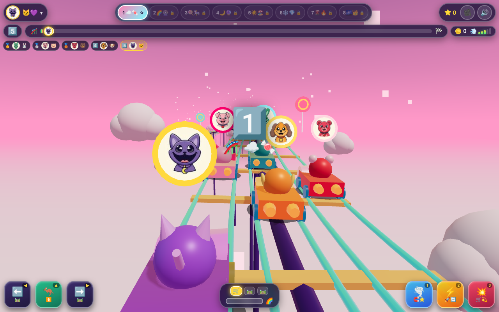

# 🎢 Critter Roller Coaster 3D: Star Track Rush! ⭐

[**▶️ Play Live on GitHub Pages**](https://kunruiw1991.github.io/critters-coaster3d/)

A **3D WebGL Spline-Track Roller Coaster Lane-Switch Racer** built with **Three.js (r161)** for young children (100% zero-text visual cockpit!). Pick your favorite **Smiling Critter** and race 4 AI rivals along a twisting 3-lane sky roller-coaster track high above floating cloud islands!

---

## 🌟 3D Engine & Gameplay Highlights

- **8 Playable Smiling Critters**: Choose **CatNap** 🌙, **DogDay** ☀️, **Bobby BearHug** ❤️, **PickyPiggy** 🍎, **Hoppy Hopscotch** ⚡, **Bubba Bubbaphant** 💡, **CraftyCorn** 🎨, or **KickinChicken** 🌟 — each riding a custom-colored 3D coaster cart with sculpted 3D ears/horns/crests and an upright camera-facing distance-scaled 3D portrait medallion!
- **3-Lane Banked 3D Spline Coaster (`CatmullRomCurve3`)**: Dual chrome running rails per lane (`laneX ± 1.08`), glowing neon center guide rails, wooden crossties, sky support trestles, signed horizontal-curvature banking (`+kappa * 14.5`), tangential hill gravity acceleration/deceleration (`-22 * tangent.y`), and 360° center-of-mass (`flipPivot`) loop-the-loop flips!
- **3 Giant Power Pedals + Rainbow Fever (`🌈`)**:
  - **🧲 `1` Star Tornado Magnet**: Spawns a spinning 3D cyan tornado ring that pulls nearby star coins from all 3 lanes directly into your cart!
  - **🚀 `2` / `Space` Rocket Flame Booster**: Ignites dual rear thruster cones, widens the camera FOV, and grants shield immunity through barrier gates!
  - **💥 `3` / `Enter` Track Shockwave Slam**: Launches an expanding 3D golden shockwave ring + energy wall that knocks back nearby rival carts (`+360°` spin) and scatters flying bonus star coins along quadratic Bézier arcs!
  - **🌈 Rainbow Fever Overdrive**: Filling the 100% Fever gauge triggers automatic hyper-speed, rainbow-cycling thruster flames, full-track magnetic coin pull, and `1.6x` faster pedal cooldown recharge!
- **Strict 5-Critter Podium & Top-3 Qualification Rules**:
  - **🥇 1st (`⭐⭐⭐`)**, **🥈 2nd (`⭐⭐`)**, or **🥉 3rd (`⭐`)** qualifies and unlocks the next coaster world!
  - **4th / 5th (`0⭐`)** displays a Sad Defeat screen (`😢💔`) with **Retry (`🔄`)** only — you must finish Top 3 to advance!

---

## 🗺️ 8 Sky Coaster Worlds

| Stage | Icon | World Theme | Track Length | Loop Arches | 3D Landmark Props & Atmosphere |
| :---: | :---: | :--- | :---: | :---: | :--- |
| **1** | ☁️ | Cloud Kingdom | `520m` | 3 | Fluffy multi-puff 3D clouds, golden sky balloons & Gentle Beginner AI |
| **2** | 🍭 | Candy Carnival | `560m` | 3 | Giant striped lollipop towers, pastel Ferris wheels & sweet sparkles |
| **3** | 💎 | Crystal Cavern | `600m` | 4 | Glowing octagram crystal spires, floating prism rings & boost pads |
| **4** | 🌴 | Dino Jungle | `640m` | 4 | Canopy palm trees, ancient stone temple arches & emerald fireflies |
| **5** | 🌋 | Lava Volcano | `680m` | 5 | Basalt obsidian pillars, glowing magma rings & rising ember sparks |
| **6** | ❄️ | Frosty Peak | `720m` | 5 | Giant 3-tier snowmen, translucent ice arches & falling snow crystals |
| **7** | 🌆 | Neon Cyber | `760m` | 6 | Cyber skyscrapers with neon windows, rotating holo-torus portals |
| **8** | 🌈 | Rainbow Galaxy | `820m` | 7 | Ringed planets, 5-band rainbow sky bridges & cosmic starfields |

---

## 🎮 Controls (Desktop & Touch)

- **Switch Lanes (`⬅️` / `➡️`)**: `ArrowLeft` / `ArrowRight` (`A` / `D`), swipe left/right on the 3D track, or tap the giant `⬅️` / `➡️` cockpit buttons.
- **Coaster Hop (`⬆️`)**: `ArrowUp` (`W`), swipe up, or tap `⬆️` to leap over `🚧` barrier gates (an urgent pulsing `⬆️🚧` alert badge warns when a gate is in your lane!).
- **Power Pedals (`🧲 1`, `🚀 2`, `💥 3`)**: Keys `1`, `2` (`Space`), `3` (`Enter`) or tap the 3 right-hand power pedals.
- **Camera View (`🎥`)**: Cycle between **Chase Cam**, **Wide Scenic Cam**, and **Action Nose Cam**.
- **Sound Synthesizer (`🔊`)**: Procedural Web Audio API synthesizer with master compressor, ascending star-coin chime streaks, victory fanfare triad, and 4-note sliding defeat trombone.

---

## 🛠️ 10-Round Critic-Creator Iterative Refinement Changelog

1. **Round 1 — 3D WebGL Scene Architecture, Lighting/Shadows & Asset Loading**: Fixed cart forward orientation (`pos - tangent` so `-Z` nose leads), corrected signed horizontal curvature banking (`+kappa * 14.5`), added dual chrome running rails (`laneX ± 1.08`), dynamic 2048² shadow frustum following the player cart, per-stage PMREM environment maps, and async texture loading barrier (`#loading-overlay`).
2. **Round 2 — 8 Smiling Critters Roster, Upright 3D Portrait Billboards & 8 Stage Worlds**: Implemented deterministic per-stage rotation of all 7 non-player rivals so all 8 critters race across Stages 1–8, upright camera-facing distance-scaled portrait medallions (`y = 4.25`), pause-on-drawer-open, hot-swap `swapPlayerCritterInPlace`, and 8 distinct 3D world landmark prop builders + ambient `THREE.Points` particle systems.
3. **Round 3 — Core 3D Coaster Physics & Tactile Collision Impact**: Added tangential slope gravity (`-22 * frame.tangent.y * dt`), elevated `flipPivot` (`y = 1.15`) so 360° barrel flips stay above the rails, full pairwise cart separation with `bumpCooldown`, `trauma²` camera shake + FOV punch, 3D knockback velocity/spin impulses, expanding 3D shockwave ring + energy wall, cart-velocity-inheriting particle bursts, and quadratic Bézier flying bonus star coins.
4. **Round 4 — 100% Zero-Text Kid-Friendly Visual Cockpit**: Eliminated duplicate `#podium-rank-chip` IDs, replaced all English text/number HUD labels with pure visual gauges (5-segment speed bar `#speed-segments`, 3-rail visual mini-map `🛤️`/`🛒`/`🚧`, pulsing `#hop-alert-badge` `⬆️🚧`, and icon-only stage & critter pills).
5. **Round 5 — 3 Interactive Power Pedals & Rainbow Fever (`🌈`) Overdrive**: Synced 3D magnet tornado ring and rainbow-cycling thruster cones/particles with Rainbow Fever, routed all Fever gains through `addFeverPoints(gain)` to extend active Fever duration, added `1.6x` faster pedal cooldown recharge during Fever, and wired keyboard press visual flash (`flashButtonPress`).
6. **Round 6 — 4 AI Rivals Behavior & Stage 1–8 Difficulty Calibration**: Enabled full AI physical interaction with `loopZones`, `boostPads`, and `gates`, implemented smart safe-lane obstacle avoidance (`isLaneSafeForCart`) and boost-pad seeking on Stages 3–8, and calibrated smooth rubber-banding so Stage 1 is a welcoming 3-star win while Stages 2–8 ramp progressively.
7. **Round 7 — Strict 5-Critter Podium & Top-3 Qualification Rules**: Locked `cart.finishOrder` at the finish line to prevent post-finish distance clamping ties, synced live HUD medal/standings on finish, styled 4th/5th place as an unmistakable crimson Sad Defeat modal (`😢💔`, `.podium-defeat`, `.active-qual`, `.retry-pulse`), disabled `btnNextStage` when not qualified, and added `Enter`/`Space` podium keyboard navigation.
8. **Round 8 — Procedural Web Audio Synthesizer & Responsive Viewport Layout**: Routed all Web Audio oscillators through a master `DynamicsCompressorNode` with `onended` cleanup, added ascending star-coin streak pitch, harmonic victory triad, and a 4-note sliding `"wah-wah-wah-waaah"` defeat trombone, plus compact mobile portrait/landscape cockpit layouts.
9. **Round 9 — End-to-End Gameplay Polish & Memory Pool Hygiene**: Reset all 128 `particlePool` slots in `clearGroupDeep` across stage switches, routed flying bonus coin fever gains through `addFeverPoints(3.5)`, auto-closed `#critter-drawer` on `Escape`, race keys, or canvas tap so young players never get stuck paused, and hardened `resize`/`visibilitychange` listeners.
10. **Round 10 — Final Verification, Screenshot Capture & GitHub Pages Deployment**: Captured live 1280×800 WebGL gameplay screenshot (`screenshot.jpg`) and deployed to `https://kunruiw1991.github.io/critters-coaster3d/`.
